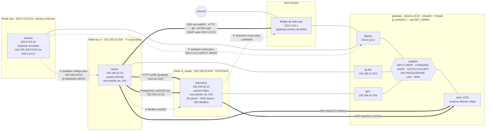
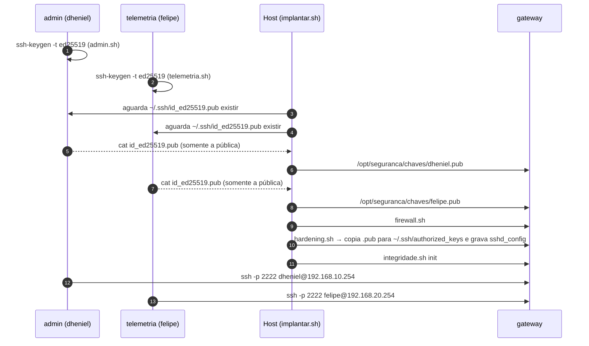
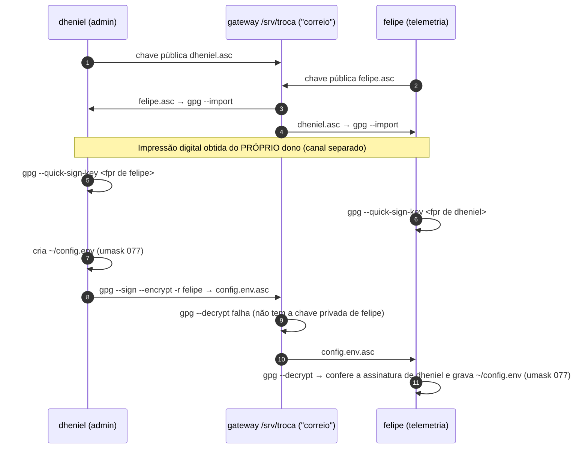

# industria4-security

Trabalho final da disciplina de **Segurança da Informação** do Bacharelado em Sistemas de Informação do **Instituto Federal Goiano – Campus Ceres**.

Este projeto é um laboratório em **Docker** que simula a borda de uma planta industrial (Indústria 4.0). Nele, um servidor Ubuntu faz o papel de **gateway/firewall** e separa três redes: a Internet (WAN), a rede corporativa (LAN de TI) e a rede de automação industrial (OT/SCADA). Sobre essa topologia são aplicados:

- **Firewall stateful** com `iptables`: política padrão de bloqueio, regras anti-varredura, anti-DoS e anti-força bruta, e NAT;
- **Hardening** do gateway: atualização, remoção de pacotes inseguros, SSH só por chave, permissões de arquivos críticos;
- **Auditoria de integridade** com SHA-256, executada pelo `cron` a cada 5 minutos;
- **Troca segura de arquivos** com GPG (cifragem e assinatura) entre dois administradores, usando o gateway como intermediário que não consegue ler o conteúdo.

---

## Sumário

1. [Requisitos e execução](#1-requisitos-e-execução)
2. [Justificativa da arquitetura](#2-justificativa-da-arquitetura)
3. [Topologia de rede](#3-topologia-de-rede)
4. [Firewall (iptables)](#4-firewall-iptables)
5. [SSH (sshd_config)](#5-ssh-sshd_config)
6. [Hardening do gateway](#6-hardening-do-gateway)
7. [Auditoria de integridade](#7-auditoria-de-integridade)
8. [Troca de chaves e arquivos com GPG](#8-troca-de-chaves-e-arquivos-com-gpg)
9. [Estrutura do projeto](#9-estrutura-do-projeto)
10. [Roteiro de verificação](#10-roteiro-de-verificação)
11. [Limitações e simplificações do laboratório](#11-limitações-e-simplificações-do-laboratório)

---

## 1. Requisitos e execução

### Requisitos

| Requisito | Motivo |
|---|---|
| Docker Engine **28 ou superior** | O `docker-compose.yml` usa a opção `com.docker.network.bridge.gateway_mode_ipv4: nat-unprotected`, que existe a partir do Docker 28. Sem ela, o Docker descarta o tráfego que o gateway roteia entre as redes (ver [seção 2.4](#24-por-que-nat-unprotected)). |
| Docker Compose v2 (`docker compose`) | É o comando usado por `implantar.sh`. |
| Bash | Os scripts `implantar.sh` e `troca_gpg.sh` rodam no host. |
| Acesso à Internet no host | O build instala pacotes com `apt-get`, e o `hardening.sh` executa `apt-get update/upgrade` dentro do gateway. |

### Implantação

```bash
git clone https://github.com/dheniiel/industria4-security
cd industria4-security
./implantar.sh      # sobe os 4 contêineres e aplica firewall, hardening e baseline de integridade
./troca_gpg.sh      # (opcional) demonstração da troca de chaves e de um arquivo cifrado via GPG
```

O `implantar.sh` faz, nesta ordem:

1. `docker compose up -d --build`: constrói a imagem `lab-ot` e sobe `gateway`, `admin`, `telemetria` e `externo`;
2. espera até que `admin` e `telemetria` tenham gerado seus pares de chaves SSH;
3. copia **apenas as chaves públicas** para `/opt/seguranca/chaves/` no gateway;
4. executa `firewall.sh`, depois `hardening.sh` e por último `integridade.sh init`.

Para desfazer o ambiente: `docker compose down`.

---

## 2. Justificativa da arquitetura

### 2.1 O problema: convergência IT/OT

Em uma indústria há dois mundos com prioridades diferentes:

| | **TI (IT)**: rede corporativa | **TO (OT)**: rede de automação |
|---|---|---|
| Ativos típicos | Estações de trabalho, servidores, acesso à Internet | CLPs, SCADA, historiadores, painéis de telemetria |
| Prioridade | Confidencialidade | **Disponibilidade** e integridade do processo físico |
| Protocolos | HTTP/HTTPS, DNS, SSH… | Modbus/TCP (502), protocolos industriais em geral **sem autenticação nem criptografia** |
| Exposição | Navega na Internet, recebe e-mails, é alvo frequente | Não deveria ter nenhum contato com a Internet |

Na Indústria 4.0 essas redes passam a se comunicar (por exemplo, a TI consulta painéis e bancos de dados de produção). Sem controle, um comprometimento na TI ou na Internet pode chegar ao processo físico. A resposta adotada no projeto é **segmentar** as redes e obrigar todo tráfego entre elas a passar por um único ponto de controle, o **gateway**, que libera apenas o mínimo necessário. Em termos de modelos de referência, é a ideia de **zonas e conduítes**: cada rede é uma zona, e o gateway é o único conduíte entre elas.

### 2.2 Decisões arquiteturais

| Decisão | Como está implementada | Justificativa de segurança |
|---|---|---|
| **Três redes separadas** | Redes Docker `wan` (203.0.113.0/24), `lan_ti` (192.168.10.0/24) e `ot_scada` (192.168.20.0/24) | Isola domínios de confiança diferentes. A OT fica em uma sub-rede própria, sem caminho direto para a Internet. |
| **Gateway único entre as redes** | Só o contêiner `gateway` está nas três redes. `admin` e `telemetria` trocam a rota padrão para o gateway (`.254`). O `externo` só alcança 192.168.0.0/16 através do IP WAN do gateway. | Ponto único de inspeção e aplicação de política. Nenhum tráfego entre zonas escapa do firewall. |
| **Roteamento habilitado só no gateway** | `sysctls: net.ipv4.ip_forward: 1` aparece apenas no serviço `gateway` | Somente o gateway encaminha pacotes. Os demais contêineres são hosts finais. |
| **Política "negar por padrão"** | `iptables -P INPUT DROP` e `-P FORWARD DROP` | Tudo o que não foi explicitamente autorizado é descartado (privilégio mínimo de rede). |
| **Firewall stateful** | Módulo `conntrack` aceita `ESTABLISHED,RELATED` e descarta `INVALID` | Apenas respostas de conexões autorizadas voltam. Pacotes forjados fora de uma conexão são descartados. |
| **OT não inicia conexões para fora e o gateway não inicia conexões para a OT** | Não há regra `FORWARD` com origem na OT. `OUTPUT -o $OT --ctstate NEW -j DROP` | A OT só *responde*. Um gateway comprometido também não pode iniciar conexões contra os ativos industriais. |
| **Modbus (502) inacessível** | A telemetria escuta na 502, mas nenhuma regra libera essa porta | O protocolo industrial mais sensível (sem autenticação) não é alcançável a partir da TI nem da Internet. |
| **Acesso ao banco só pelo administrador** | `FORWARD ... -s 192.168.10.10 -d 192.168.20.10 --dport 5432` | Dados de produção ficam restritos a uma única estação autorizada. |
| **NAT apenas para a LAN** | `MASQUERADE` só para `-s 192.168.10.0/24 -o $WAN` | Somente a TI navega, e com o IP público do gateway, sem expor os endereços internos. A OT não tem tradução nem regra de saída. |
| **Administração do gateway por SSH com chave e porta não padrão** | `sshd` na porta 2222, sem senha, sem root, `AllowUsers` | Reduz a superfície de ataque e elimina a força bruta de senhas (ver [seção 5](#5-ssh-sshd_config)). |
| **Chave privada nunca sai do dono** | Cada administrador gera o próprio par SSH e GPG no seu contêiner. Só as públicas são copiadas. | Segue a premissa básica da criptografia assimétrica. |
| **Detecção de alterações** | `integridade.sh` + `cron` | Contas (`/etc/passwd`, `/etc/shadow`) e regras de firewall alteradas sem autorização geram alerta. |
| **Atacante simulado** | Contêiner `externo` na WAN, que mantém `nmap`, `telnet`, `ftp` e `rsh` | Permite testar o firewall pelo lado da Internet. |

### 2.3 Finalidade de cada componente

| Contêiner | Papel no cenário | Redes / IP | Serviços e usuários |
|---|---|---|---|
| `gateway` | Servidor Ubuntu: roteador, firewall, NAT, ponto de administração e "correio" GPG | `wan` 203.0.113.2 · `lan_ti` 192.168.10.254 · `ot_scada` 192.168.20.254 | `sshd` (2222), `cron`. Usuários `dheniel` e `felipe` (grupo `adminseg`), criados pelo `hardening.sh` |
| `admin` | Estação de administração na LAN de TI | `lan_ti` 192.168.10.10 | Usuário `dheniel` com pares de chaves SSH (Ed25519) e GPG |
| `telemetria` | Servidor industrial na rede OT | `ot_scada` 192.168.20.10 | Usuário `felipe` com pares SSH e GPG. Serviços simulados: painel (80), banco (5432) e CLP Modbus (502) |
| `externo` | Atacante simulado na Internet | `wan` 203.0.113.10 | Ferramentas de teste (`nmap`, `telnet`, `ftp`, `rsh`) |

### 2.4 Por que `nat-unprotected`

Nas três redes do `docker-compose.yml` está definido:

```yaml
driver_opts: { com.docker.network.bridge.gateway_mode_ipv4: nat-unprotected }
```

A partir do Docker 28, o host passa a descartar pacotes que chegam a uma rede bridge vindos de outra rede quando não houve publicação de portas. No laboratório, porém, é o **contêiner gateway** que roteia entre as redes. Com o modo `nat-unprotected`, o host deixa de bloquear esse tráfego e quem decide o que passa é o **iptables do gateway**, que é exatamente o que se quer demonstrar. O comentário no próprio arquivo registra essa necessidade.

---

## 3. Topologia de rede

### 3.1 Diagrama

> Os nomes das interfaces do gateway **não são fixos**: o Docker não garante a ordem `eth0/eth1/eth2`. Por isso o `firewall.sh` descobre cada interface a partir do IP (`ip -o -4 addr show to <IP>`) e guarda o resultado nas variáveis `$WAN`, `$LAN` e `$OT`, que são os nomes usados no diagrama.



**Legenda:** setas grossas (`==>`) são fluxos **permitidos** e o sentido indica quem inicia a conexão. Setas tracejadas com `✗` são fluxos **bloqueados**. As respostas dos fluxos permitidos voltam pela regra `ESTABLISHED,RELATED`.

### 3.2 Endereçamento

| Rede Docker | Sub-rede | Função | Gateway definido no compose | Hosts |
|---|---|---|---|---|
| `wan` | 203.0.113.0/24 (TEST-NET-3, faixa reservada para documentação) | Simula a Internet | 203.0.113.1 (host Docker) | `gateway` .2 · `externo` .10 |
| `lan_ti` | 192.168.10.0/24 | Rede corporativa (TI) | não definido (o Docker atribui o padrão) | `gateway` .254 · `admin` .10 |
| `ot_scada` | 192.168.20.0/24 | Rede industrial (OT/SCADA) | não definido (o Docker atribui o padrão) | `gateway` .254 · `telemetria` .10 |

### 3.3 Rotas configuradas pelos scripts de inicialização

| Contêiner | Comando | Efeito |
|---|---|---|
| `gateway` | `route del default` + `route add default gw 203.0.113.1` | A saída para a Internet passa a ser pela WAN, e não pela rede que o Docker escolheu como padrão. |
| `admin` | `route del default` + `route add default gw 192.168.10.254` | Todo tráfego para fora da LAN passa obrigatoriamente pelo gateway. |
| `telemetria` | `route del default` + `route add default gw 192.168.20.254` | Todo tráfego para fora da OT passa obrigatoriamente pelo gateway. |
| `externo` | `route add -net 192.168.0.0 netmask 255.255.0.0 gw 203.0.113.2` | O atacante "sabe" que as redes internas ficam atrás da WAN do gateway. Assim os testes batem no firewall, como aconteceria na vida real. |

### 3.4 Matriz de comunicação resultante

| Origem | Destino | Protocolo/porta | Resultado | Regra responsável |
|---|---|---|---|---|
| `admin` (192.168.10.10) | gateway 192.168.10.254 | TCP 2222 (SSH) | ✅ Permitido (até 4/min, rajada de 5) | INPUT #8 |
| `telemetria` (192.168.20.10) | gateway 192.168.20.254 | TCP 2222 (SSH) | ✅ Permitido (até 4/min, rajada de 5) | INPUT #9 |
| Qualquer host da LAN | `telemetria` | TCP 80 (painel) | ✅ Permitido | FORWARD #7 |
| `admin` | `telemetria` | TCP 5432 (banco) | ✅ Permitido | FORWARD #8 |
| Outro host da LAN | `telemetria` | TCP 5432 | ❌ Bloqueado | política FORWARD |
| Qualquer host da LAN | `telemetria` | TCP 502 (Modbus) | ❌ Bloqueado | política FORWARD |
| Qualquer host da LAN | Internet | TCP 53/80/443, UDP 53 | ✅ Permitido com NAT | FORWARD #9, #10 + POSTROUTING |
| Qualquer host da LAN | Internet | outras portas, ICMP | ❌ Bloqueado | política FORWARD |
| `telemetria` / OT | LAN ou Internet | qualquer (conexão nova) | ❌ Bloqueado | política FORWARD |
| `gateway` | OT | qualquer (conexão nova) | ❌ Bloqueado | OUTPUT #1 |
| `gateway` | WAN / LAN | qualquer | ✅ Permitido | política OUTPUT ACCEPT |
| `externo` / Internet | gateway 203.0.113.2 | qualquer | ❌ Bloqueado | política INPUT |
| `externo` / Internet | 192.168.10.0/24 ou 192.168.20.0/24 | qualquer | ❌ Bloqueado | política FORWARD |
| Qualquer host | gateway | ICMP (ping) | ❌ Bloqueado (não há regra para ICMP) | política INPUT |

---

## 4. Firewall (iptables)

Arquivo: [`gateway/firewall.sh`](gateway/firewall.sh). É executado pelo `implantar.sh` e **reexecutado a cada inicialização** do contêiner pelo `inicializacao/gateway.sh`.

### 4.1 Variáveis

```bash
iface() { ip -o -4 addr show to "$1" | awk '{print $2}'; }
WAN=$(iface 203.0.113.2); LAN=$(iface 192.168.10.254); OT=$(iface 192.168.20.254)
ADMIN=192.168.10.10
TELEMETRIA=192.168.20.10
```

| Variável | Valor | Uso |
|---|---|---|
| `iface()` | função | Recebe um IP e devolve o nome da interface que o possui. Isso evita regras amarradas a `eth0/eth1/eth2`, cuja ordem o Docker não garante. |
| `$WAN` | interface com 203.0.113.2 | Interface externa |
| `$LAN` | interface com 192.168.10.254 | Interface da TI |
| `$OT` | interface com 192.168.20.254 | Interface da OT |
| `$ADMIN` | 192.168.10.10 | Estação de administração |
| `$TELEMETRIA` | 192.168.20.10 | Servidor de telemetria/banco |

### 4.2 Limpeza e políticas padrão

```bash
iptables -F; iptables -X; iptables -t nat -F
iptables -P INPUT   DROP
iptables -P FORWARD DROP
iptables -P OUTPUT  ACCEPT
```

| Comando | Significado | Finalidade |
|---|---|---|
| `iptables -F` | Apaga todas as regras da tabela `filter` | Garante que o script é **idempotente**: reaplicar não duplica regras. |
| `iptables -X` | Apaga as cadeias criadas pelo usuário | Remove restos de configurações anteriores. |
| `iptables -t nat -F` | Apaga as regras da tabela `nat` | Evita duplicar o `MASQUERADE` a cada execução. |
| `-P INPUT DROP` | Descarta por padrão tudo o que é destinado ao próprio gateway | **Negar por padrão**: o gateway só aceita o que for liberado abaixo. |
| `-P FORWARD DROP` | Descarta por padrão tudo o que seria roteado entre as redes | Nenhuma comunicação entre WAN, LAN e OT existe sem regra explícita. |
| `-P OUTPUT ACCEPT` | O gateway pode iniciar conexões | Necessário, por exemplo, para o `apt-get update/upgrade` do hardening e para a resolução DNS (8.8.8.8). A exceção para a OT é tratada na regra OUTPUT #1. |

### 4.3 Cadeia `INPUT` (tráfego destinado ao gateway)

As regras 2 a 7 são criadas por um laço `for C in INPUT FORWARD` e por isso se repetem de forma idêntica na cadeia `FORWARD`. A ordem importa: o iptables avalia de cima para baixo e para na primeira regra que casar.

| # | Regra | Protocolo | Origem → Destino | Ação | Finalidade de segurança |
|---|---|---|---|---|---|
| 1 | `-i lo -j ACCEPT` | todos | loopback | ACCEPT | Processos locais do gateway conversam entre si via 127.0.0.1. Sem isso, serviços locais quebrariam. |
| 2 | `-m conntrack --ctstate INVALID -j DROP` | todos | qualquer | DROP | Descarta pacotes que o rastreamento de conexões não consegue associar a nenhuma conexão válida (malformados, fora de sequência, forjados). |
| 3 | `-p tcp --tcp-flags ALL NONE -j DROP` | TCP | qualquer | DROP | **NULL scan**: pacote TCP sem nenhuma flag ligada. Não existe em tráfego legítimo e é usado por ferramentas como `nmap -sN` para mapear portas. |
| 4 | `-p tcp --tcp-flags ALL FIN,PSH,URG -j DROP` | TCP | qualquer | DROP | **XMAS scan**: entre todas as flags, apenas FIN, PSH e URG ligadas (`nmap -sX`). Também é técnica de reconhecimento. |
| 5 | `-p tcp ! --syn -m conntrack --ctstate NEW -j DROP` | TCP | qualquer | DROP | Toda conexão TCP legítima começa com SYN. Um pacote que abriria uma conexão nova **sem** SYN (por exemplo ACK ou FIN scan) é descartado. |
| 6 | `-m conntrack --ctstate ESTABLISHED,RELATED -j ACCEPT` | todos | qualquer | ACCEPT | **Stateful**: aceita respostas de conexões já autorizadas (ESTABLISHED) e conexões relacionadas, como mensagens ICMP de erro (RELATED). Fica antes das regras de liberação para que o tráfego de conexões existentes seja processado rapidamente. |
| 7 | `-p tcp --syn -m hashlimit --hashlimit-above 20/sec --hashlimit-burst 40 --hashlimit-mode srcip --hashlimit-name dos_INPUT -j DROP` | TCP | qualquer | DROP | **Anti-DoS / anti-SYN flood**: mantém um contador **por IP de origem** (`srcip`). Se um mesmo IP enviar mais de 20 SYN por segundo, após uma rajada inicial de 40, o excedente é descartado. |
| 8 | `-i $LAN -s 192.168.10.10 -p tcp --dport 2222 -m limit --limit 4/min --limit-burst 5 -j ACCEPT` | TCP 2222 | `admin` → gateway (pela interface LAN) | ACCEPT | SSH do administrador `dheniel`. A exigência simultânea de **interface + IP** impede que alguém use o IP 192.168.10.10 chegando por outra interface (anti-spoofing). O `limit` aceita no máximo 4 novas conexões por minuto (rajada de 5). O excedente não casa e cai na política DROP, o que freia **força bruta**. |
| 9 | `-i $OT -s 192.168.20.10 -p tcp --dport 2222 -m limit --limit 4/min --limit-burst 5 -j ACCEPT` | TCP 2222 | `telemetria` → gateway (pela interface OT) | ACCEPT | SSH do administrador `felipe`, com as mesmas proteções da regra 8. É o **único** fluxo iniciado pela OT que o gateway aceita. |
| — | política `DROP` | — | todo o resto | DROP | Qualquer acesso da WAN ao gateway, ping, SSH vindo de outros IPs ou SSH na porta 22. |

> **Por que o `limit` só afeta conexões novas?** Os pacotes de uma sessão SSH já aberta são aceitos antes pela regra 6 (`ESTABLISHED`), então só pacotes de conexões novas chegam às regras 8 e 9. O `--limit` do módulo `limit` é um contador único da regra. Como cada regra já está restrita a um único IP, na prática ele funciona como um limite por administrador.

### 4.4 Cadeia `FORWARD` (tráfego roteado entre as redes)

As regras 1 a 6 são as mesmas proteções da `INPUT` (itens 2 a 7 acima), geradas pelo mesmo laço. O contador anti-DoS é separado (`--hashlimit-name dos_FORWARD`).

| # | Regra | Protocolo/porta | Origem → Destino | Ação | Finalidade de segurança |
|---|---|---|---|---|---|
| 1 | `--ctstate INVALID -j DROP` | todos | qualquer | DROP | Igual à INPUT #2 |
| 2 | `--tcp-flags ALL NONE -j DROP` | TCP | qualquer | DROP | NULL scan atravessando o gateway |
| 3 | `--tcp-flags ALL FIN,PSH,URG -j DROP` | TCP | qualquer | DROP | XMAS scan atravessando o gateway |
| 4 | `! --syn --ctstate NEW -j DROP` | TCP | qualquer | DROP | Conexão nova sem SYN |
| 5 | `--ctstate ESTABLISHED,RELATED -j ACCEPT` | todos | qualquer | ACCEPT | Respostas das conexões liberadas abaixo. É o que permite, por exemplo, que a telemetria **responda** ao admin sem nunca poder **iniciar** uma conexão. |
| 6 | `--syn -m hashlimit ... dos_FORWARD -j DROP` | TCP | qualquer | DROP | Anti-DoS por IP de origem para o tráfego que atravessa o gateway. Protege os ativos da OT contra inundação de SYN vinda da LAN. |
| 7 | `-i $LAN -o $OT -d 192.168.20.10 -p tcp --dport 80 -j ACCEPT` | TCP 80 | **qualquer host da LAN** → telemetria | ACCEPT | Consulta ao **painel de telemetria** (HTTP). É o único serviço da OT aberto a toda a TI. |
| 8 | `-i $LAN -o $OT -s 192.168.10.10 -d 192.168.20.10 -p tcp --dport 5432 -j ACCEPT` | TCP 5432 | **somente `admin`** → telemetria | ACCEPT | Acesso ao **banco de dados industrial** (porta padrão do PostgreSQL), restrito à estação de administração. |
| 9 | `-i $LAN -o $WAN -p tcp -m multiport --dports 53,80,443 -j ACCEPT` | TCP 53, 80, 443 | LAN → Internet | ACCEPT | Navegação da TI: DNS sobre TCP, HTTP e HTTPS. O módulo `multiport` agrupa as três portas em uma regra. |
| 10 | `-i $LAN -o $WAN -p udp --dport 53 -j ACCEPT` | UDP 53 | LAN → Internet | ACCEPT | Consultas DNS (UDP, que é o transporte usual do DNS). |
| — | política `DROP` | — | todo o resto | DROP | Bloqueia, entre outros: Internet → LAN/OT, OT → LAN, OT → Internet, LAN → OT em qualquer porta que não seja 80/5432 (inclusive **Modbus 502**) e LAN → Internet em outras portas. |

### 4.5 Cadeia `OUTPUT` (tráfego gerado pelo gateway)

| # | Regra | Origem → Destino | Ação | Finalidade de segurança |
|---|---|---|---|---|
| 1 | `-o $OT -m conntrack --ctstate NEW -j DROP` | gateway → rede OT | DROP | O gateway **não inicia** conexões para a OT. Se o gateway for comprometido, ele não serve de ponte para atacar os ativos industriais. Respostas (por exemplo, a sessão SSH de `felipe`) continuam saindo, porque não são `NEW`. |
| — | política `ACCEPT` | gateway → WAN/LAN | ACCEPT | Atualizações de pacotes, DNS e conexões administrativas. |

> Pacotes **roteados** (cadeia FORWARD) não passam pela OUTPUT. Essa regra afeta apenas o tráfego originado no próprio gateway.

### 4.6 Tabela `nat`

| Cadeia | Regra | Finalidade |
|---|---|---|
| `POSTROUTING` | `-o $WAN -s 192.168.10.0/24 -j MASQUERADE` | **SNAT dinâmico**: pacotes da LAN que saem pela WAN recebem o IP do gateway (203.0.113.2) como origem. Esconde o endereçamento interno e permite que as respostas voltem ao gateway, que desfaz a tradução. Só a LAN é traduzida. A OT **não** tem NAT nem regra de saída, então não alcança a Internet. |

### 4.7 Persistência para auditoria

```bash
mkdir -p /etc/iptables
iptables-save | sed -e '/^#/d' -e 's/ \[[0-9]*:[0-9]*\]//' > /etc/iptables/rules.v4
chmod 600 /etc/iptables/rules.v4
```

| Etapa | Finalidade |
|---|---|
| `iptables-save` | Exporta o conjunto de regras ativo. |
| `sed -e '/^#/d'` | Remove os comentários, que incluem data e hora da exportação. |
| `sed -e 's/ \[[0-9]*:[0-9]*\]//'` | Remove os contadores de pacotes/bytes `[pacotes:bytes]` das cadeias. |
| `chmod 600` | Somente o root lê e escreve o arquivo. |

Sem a data e os contadores, o conteúdo do arquivo (e portanto seu hash SHA-256) **só muda quando as regras mudam**. É esse arquivo que o `integridade.sh` monitora. Observe que o `rules.v4` serve à auditoria: a reaplicação das regras na inicialização é feita executando novamente o `firewall.sh`, e não restaurando esse arquivo.

---

## 5. SSH (sshd_config)

O `hardening.sh` **substitui integralmente** o `/etc/ssh/sshd_config` do gateway pelo conteúdo abaixo (via *here-document*; `$ADMINS` é expandido para `dheniel felipe`):

```text
# Porta padrão (22) alterada
Port 2222
# Sem login direto do root
PermitRootLogin no
# Só os administradores
AllowUsers dheniel felipe
# Autenticação exclusiva por chave pública/privada
PubkeyAuthentication yes
PasswordAuthentication no
KbdInteractiveAuthentication no
# Necessárias para o sistema: PAM (contas sem senha) e SFTP (usado pelo scp)
UsePAM yes
Subsystem sftp /usr/lib/openssh/sftp-server
```

### 5.1 Parâmetros

| Parâmetro | Valor | Explicação técnica | Contribuição para a segurança |
|---|---|---|---|
| `Port` | `2222` | Porta TCP em que o `sshd` escuta. | Tira o serviço da porta 22, que é o alvo de varreduras e robôs automatizados. Não é uma proteção por si só (segurança por obscuridade), mas reduz ruído e ataques oportunistas. A porta tem de coincidir com as regras INPUT #8 e #9 do firewall. |
| `PermitRootLogin` | `no` | Recusa qualquer autenticação como `root`. | O atacante precisa adivinhar também um nome de usuário válido. As ações administrativas ficam associadas a contas nominais (`dheniel`, `felipe`), o que favorece a rastreabilidade. |
| `AllowUsers` | `dheniel felipe` | Lista branca: somente esses usuários podem autenticar. Qualquer outro é recusado, mesmo com credencial válida. | Contas de serviço ou criadas indevidamente não ganham acesso remoto. É o controle de **quem** entra. O firewall controla **de onde** se entra. |
| `PubkeyAuthentication` | `yes` | Habilita autenticação por par de chaves. O servidor confere a assinatura feita com a chave privada do cliente contra o `~/.ssh/authorized_keys`. | É o **único** método habilitado. As chaves dos usuários são Ed25519, geradas em `admin.sh` e `telemetria.sh`. |
| `PasswordAuthentication` | `no` | Desabilita a autenticação por senha. | Elimina por completo a **força bruta e o roubo de senhas** no SSH. Sem a chave privada não há como entrar. |
| `KbdInteractiveAuthentication` | `no` | Desabilita o método *keyboard-interactive* (desafio/resposta, normalmente via PAM). | Fecha um caminho alternativo pelo qual uma senha ainda poderia ser pedida, mesmo com `PasswordAuthentication no`. |
| `UsePAM` | `yes` | O `sshd` usa o PAM nas fases de conta e sessão. | Necessário para o funcionamento do ambiente: as contas são criadas por `useradd` **sem senha**, ficando com a senha bloqueada (`!` no `/etc/shadow`). Com `UsePAM no`, o OpenSSH trata contas assim como bloqueadas e recusa o login mesmo com chave. Com o PAM, a autenticação por senha continua desabilitada pelos dois parâmetros anteriores. |
| `Subsystem sftp` | `/usr/lib/openssh/sftp-server` | Registra o subsistema SFTP. | Permite transferências cifradas de arquivo (`sftp` e `scp`, que nas versões atuais do OpenSSH usa SFTP por padrão), substituindo protocolos inseguros como FTP, que o próprio hardening remove. |

### 5.2 Validação e efeitos colaterais

- `sshd -t && service ssh restart`: o `sshd -t` valida a sintaxe do arquivo e o serviço só é reiniciado se não houver erro. Isso evita derrubar o acesso por causa de uma configuração inválida.
- `chmod 600 /etc/ssh/sshd_config` (seção 5 do `hardening.sh`): só o root lê e altera a configuração.
- Como o arquivo é reescrito por completo, os demais parâmetros assumem os **valores padrão** do OpenSSH. Isso inclui a ausência da diretiva `Include /etc/ssh/sshd_config.d/*.conf` presente no arquivo original do Ubuntu, então arquivos nesse diretório deixam de ser lidos.

### 5.3 Provisionamento das chaves



Permissões aplicadas pelo `hardening.sh` a cada usuário: `~/.ssh` com `700` e `~/.ssh/authorized_keys` com `600`, ambos pertencentes ao próprio usuário. O OpenSSH (com o padrão `StrictModes yes`) recusa chaves cujos arquivos tenham permissões frouxas.

---

## 6. Hardening do gateway

Arquivo: [`gateway/hardening.sh`](gateway/hardening.sh).

| Etapa | Comandos | Finalidade |
|---|---|---|
| 1. Atualização | `apt-get update` e `apt-get -y upgrade` (não interativo) | Aplica correções de segurança disponíveis para os pacotes instalados. |
| 2. Remoção de pacotes | `apt-get -y purge telnet inetutils-telnet ftp tnftp rsh-redone-client nmap` e `autoremove --purge` | Remove clientes que transmitem dados e credenciais **sem criptografia** (telnet, ftp, rsh) e o scanner `nmap`, que facilitaria o reconhecimento da rede a partir de um gateway comprometido. O `autoremove` elimina dependências órfãs. |
| 3. Contas administrativas | `groupadd -f adminseg`, `useradd -m -s /bin/bash` (sem senha), `usermod -aG adminseg`, cópia da chave pública para `authorized_keys` com permissões 700/600 | Cria contas nominais para `dheniel` e `felipe`, acessíveis apenas por chave. O teste `id "$u"` torna a etapa idempotente. |
| Pasta de troca GPG | `/srv/troca` com dono `root:adminseg` e modo `770` | Diretório usado como "correio" pelo `troca_gpg.sh`. Só o root e o grupo `adminseg` acessam. |
| 4. SSH | Gera o `sshd_config`, valida e reinicia | Ver [seção 5](#5-ssh-sshd_config). |
| 5. Permissões críticas | ver tabela abaixo | Reduz a chance de alteração ou leitura indevida de arquivos sensíveis. |
| Agendamento | Linha no `/etc/crontab` e `service cron start` | Verificação de integridade a cada 5 minutos (ver [seção 7](#7-auditoria-de-integridade)). |

Permissões aplicadas na etapa 5:

| Comando | Efeito |
|---|---|
| `chown root:root /etc && chmod 755 /etc` | `/etc` pertence ao root. Só ele escreve, os demais apenas leem e atravessam. |
| `chmod -R o-w /etc` | Nenhum arquivo ou diretório dentro de `/etc` fica gravável por "outros". |
| `chown root:shadow /etc/shadow /etc/gshadow && chmod 640 ...` | Hashes de senha legíveis apenas pelo root e pelo grupo `shadow`. |
| `chmod 600 /etc/ssh/sshd_config` | Configuração do SSH restrita ao root. |
| `chmod -R o-rwx /var/log` | Logs inacessíveis para "outros". Evita vazamento de informações e a leitura do `integridade.log` por usuários comuns. |

Cron:

```text
*/5 * * * * root /opt/seguranca/integridade.sh verificar >/dev/null
```

O `grep -q integridade.sh /etc/crontab ||` impede que a linha seja duplicada se o script rodar novamente.

---

## 7. Auditoria de integridade

Arquivo: [`gateway/integridade.sh`](gateway/integridade.sh).

| Item | Valor |
|---|---|
| Arquivos monitorados | `/etc/passwd` (contas), `/etc/shadow` (senhas/bloqueios), `/etc/iptables/rules.v4` (regras de firewall) |
| Baseline | `/var/lib/integridade/baseline.sha256` (diretório `700`, arquivo `600`) |
| Log | `/var/log/integridade.log` |
| Algoritmo | SHA-256 (`sha256sum`) |

| Modo | Funcionamento | Código de saída |
|---|---|---|
| `init` | Cria o diretório da baseline (`${BASE%/*}` é a expansão do Bash que retira o nome do arquivo e deixa o diretório), grava os hashes atuais, registra `BASELINE criada` no log e exibe os hashes. | 0 |
| `verificar` | Recalcula os hashes e compara com a baseline usando `diff` (`<` é o valor guardado, `>` é o valor atual). Sem diferença: registra `OK` e mostra **OK** em verde. Com diferença: registra `ALERTA` com o `diff` no log e mostra **ALERTA DE INTEGRIDADE** em destaque. | 0 (íntegro) / 1 (alerta) |
| outro | Exibe `Uso: ... {init\|verificar}` | 2 |

A baseline é criada **por último** no `implantar.sh`, depois que o `firewall.sh` gerou o `rules.v4` e o `hardening.sh` criou as contas e alterou `/etc/passwd` e `/etc/shadow`. Assim, as mudanças legítimas da implantação não disparam alertas.

Exemplo de detecção (criação de uma conta não autorizada no gateway):

```bash
docker exec gateway useradd intruso
docker exec gateway /opt/seguranca/integridade.sh verificar   # → ALERTA, com o diff de /etc/passwd e /etc/shadow
docker exec gateway tail /var/log/integridade.log
```

---

## 8. Troca de chaves e arquivos com GPG

Arquivo: [`troca_gpg.sh`](troca_gpg.sh), executado no host. Demonstra **confidencialidade, autenticidade e integridade** de um arquivo trafegado por um intermediário não confiável, o gateway, chamado de "correio" (`/srv/troca`).

Cada administrador já possui um par de chaves GPG gerado na inicialização do seu contêiner (`gpg --quick-gen-key`, algoritmo padrão do GnuPG, identidades `dheniel@industria4.local` e `felipe@industria4.local`).



| Passo | O que o script faz | Propriedade demonstrada |
|---|---|---|
| 1 | Cada um exporta a chave pública (`--armor`) para o correio | Distribuição de chaves públicas |
| 2 | Cada um importa a chave do colega a partir do correio | — |
| 3 | A impressão digital (*fingerprint*) é lida **diretamente no contêiner do dono** e usada em `--quick-sign-key`. Com `set -e`, se o correio tivesse entregue uma chave trocada, o fingerprint não existiria no chaveiro de quem recebeu, a assinatura falharia e o script pararia. Ao final, `--check-sigs` mostra as assinaturas. | Proteção contra **man-in-the-middle** na troca de chaves (verificação fora de banda) |
| 4 | `dheniel` cria `config.env` com credenciais fictícias (permissão restrita por `umask 077`), **assina e cifra** para o fingerprint de `felipe` e deposita no correio | Confidencialidade + autenticidade |
| 5 | O gateway mostra o início do arquivo (só texto ASCII-armored) e tenta decifrar, sem sucesso | O intermediário guarda o arquivo mas **não consegue lê-lo** |
| 6 | `felipe` decifra (com `umask 077`), o GPG valida a assinatura de `dheniel` e o conteúdo é exibido | Integridade e não repúdio da origem |

---

## 9. Estrutura do projeto

```text
industria4-security/
├── Dockerfile                  # Imagem única "lab-ot" usada pelos 4 contêineres
├── docker-compose.yml          # Redes (wan, lan_ti, ot_scada) e serviços
├── implantar.sh                # Orquestra a implantação completa (executado no host)
├── troca_gpg.sh                # Demonstração da troca GPG (executado no host)
├── README.md                   # Esta documentação
├── gateway/                    # Scripts de segurança do servidor → /opt/seguranca/
│   ├── firewall.sh             # Regras iptables + NAT + rules.v4
│   ├── hardening.sh            # Atualização, remoção de pacotes, contas, SSH, permissões, cron
│   └── integridade.sh          # Auditoria SHA-256 (init | verificar)
└── inicializacao/              # Ponto de entrada de cada contêiner → /opt/inicializacao/
    ├── gateway.sh              # Rota WAN, DNS, firewall, ssh e cron
    ├── admin.sh                # Rota, usuário dheniel, chaves GPG/SSH
    ├── telemetria.sh           # Rota, usuário felipe, chaves GPG/SSH, serviços 80/5432/502
    └── externo.sh              # Rota para as redes internas via WAN do gateway
```

### 9.1 Arquivos da raiz

#### `Dockerfile`

Define a imagem **única** `lab-ot` (base `ubuntu:24.04`), compartilhada pelos quatro contêineres. O papel de cada um é definido pelo script de inicialização indicado no `docker-compose.yml`.

| Instrução | Finalidade |
|---|---|
| `FROM ubuntu:24.04` | Base Ubuntu LTS, representando o "servidor Ubuntu" do cenário. |
| `apt-get install -y ...` | `iptables` (firewall), `net-tools` (`route`), `iproute2` (`ip`), `iputils-ping`, `openssh-server` e `openssh-client`, `gnupg`, `cron`, `python3` (serviços simulados), `curl`, `nmap`, e os clientes inseguros `telnet`, `ftp` e `rsh-redone-client`. Os clientes inseguros e o `nmap` entram na imagem para que o atacante (`externo`) tenha ferramentas e para que o hardening tenha o que remover no gateway (em `admin` e `telemetria`, `nmap` e `telnet` são removidos na inicialização). |
| `mkdir -p /run/sshd` | Diretório de privilege separation exigido pelo `sshd` para iniciar. |
| `COPY gateway/ /opt/seguranca/` + `chmod 700` | Scripts de segurança, acessíveis e executáveis só pelo root. |
| `COPY inicializacao/ /opt/inicializacao/` + `chmod 700` | Scripts de inicialização, com a mesma restrição. |

#### `docker-compose.yml`

Declara as **redes** e os **serviços**.

Redes (todas com `nat-unprotected`, ver [seção 2.4](#24-por-que-nat-unprotected)):

| Rede | Sub-rede | Gateway |
|---|---|---|
| `wan` | 203.0.113.0/24 | 203.0.113.1 |
| `lan_ti` | 192.168.10.0/24 | padrão do Docker |
| `ot_scada` | 192.168.20.0/24 | padrão do Docker |

Serviços (todos com `build: .`, `image: lab-ot` e `cap_add: [NET_ADMIN]`, que é necessário para alterar rotas e, no gateway, regras de iptables):

| Serviço | Particularidades | `command` |
|---|---|---|
| `gateway` | `sysctls: net.ipv4.ip_forward: 1`. IPs fixos nas três redes. | `bash /opt/inicializacao/gateway.sh` |
| `admin` | `lan_ti` 192.168.10.10 | `bash /opt/inicializacao/admin.sh` |
| `telemetria` | `ot_scada` 192.168.20.10 | `bash /opt/inicializacao/telemetria.sh` |
| `externo` | `wan` 203.0.113.10 | `bash /opt/inicializacao/externo.sh` |

#### `implantar.sh`

Script de implantação executado no host (detalhado na [seção 1](#1-requisitos-e-execução)).

- `set -eo pipefail`: interrompe o script no primeiro erro, inclusive em qualquer parte de um pipe (`|`).
- Laço `until ... test -f ...; do sleep 1; done`: espera as chaves SSH serem geradas pela inicialização dos contêineres.
- Transferência das chaves públicas por pipe (`docker exec admin cat ... | docker exec -i gateway tee ...`): a chave privada **nunca** é lida nem copiada.
- Ordem final `firewall.sh` → `hardening.sh` → `integridade.sh init`: a baseline captura o estado já endurecido.

#### `troca_gpg.sh`

Demonstração da troca de chaves e do arquivo cifrado (detalhada na [seção 8](#8-troca-de-chaves-e-arquivos-com-gpg)). Usa `set -e`, `docker exec -u <usuário>` para agir como cada administrador e `CORREIO=/srv/troca` no gateway.

#### `README.md`

Documentação do projeto.

### 9.2 Diretório `gateway/` (copiado para `/opt/seguranca/`)

Os três scripts estão presentes em todos os contêineres, porque a imagem é única, mas só são executados no `gateway`.

| Arquivo | Executado por | Função |
|---|---|---|
| `firewall.sh` | `implantar.sh` e `inicializacao/gateway.sh` (a cada boot) | Aplica as regras de iptables e NAT e salva `/etc/iptables/rules.v4`. Ver [seção 4](#4-firewall-iptables). |
| `hardening.sh` | `implantar.sh` (uma vez) | Atualiza o sistema, remove pacotes inseguros, cria as contas, configura o SSH, ajusta permissões e agenda a auditoria. Ver [seções 5](#5-ssh-sshd_config) e [6](#6-hardening-do-gateway). |
| `integridade.sh` | `implantar.sh` (`init`) e `cron` a cada 5 min (`verificar`) | Auditoria de integridade com SHA-256. Ver [seção 7](#7-auditoria-de-integridade). |

O `hardening.sh` também lê o subdiretório `/opt/seguranca/chaves/`, que **não existe no repositório**: é criado pelo `implantar.sh` em tempo de implantação com `dheniel.pub` e `felipe.pub`.

### 9.3 Diretório `inicializacao/` (copiado para `/opt/inicializacao/`)

Cada script é o processo principal (`command`) do seu contêiner e termina em `sleep infinity`, que mantém o contêiner em execução.

#### `gateway.sh`

| Ação | Comando |
|---|---|
| Rota padrão pela WAN | `route del default` + `route add default gw 203.0.113.1` |
| DNS | `echo nameserver 8.8.8.8 > /etc/resolv.conf` |
| Reaplica o firewall a cada boot (as regras do iptables não sobrevivem ao reinício) | `/opt/seguranca/firewall.sh` |
| Sobe os serviços (as configurações feitas pelo hardening ficam gravadas na camada do contêiner) | `service ssh start` e `service cron start` |

> Na primeira subida o `sshd` inicia com a configuração padrão da imagem. A configuração endurecida só passa a valer quando o `hardening.sh` reescreve o `sshd_config` e reinicia o serviço. Durante esse intervalo, o firewall já aplicado só aceita conexões na porta 2222.

#### `admin.sh`

| Ação | Comando |
|---|---|
| Rota padrão pelo gateway | `route add default gw 192.168.10.254` |
| Usuário `dheniel` (idempotente) | `id dheniel \|\| useradd -m -s /bin/bash dheniel` |
| Par GPG (se ainda não existir) | `gpg --batch --passphrase '' --quick-gen-key 'dheniel <dheniel@industria4.local>'` |
| Par SSH Ed25519 (se ainda não existir) | `ssh-keygen -q -t ed25519 -N '' -f ~/.ssh/id_ed25519` |
| Remove ferramentas desnecessárias | `apt-get purge nmap telnet inetutils-telnet` |

#### `telemetria.sh`

Mesmas etapas do `admin.sh` para o usuário `felipe` (rota via 192.168.20.254, identidade `felipe@industria4.local`), e ainda os **serviços industriais simulados**:

```bash
cd /tmp
python3 -m http.server 80 &     # painel de telemetria
python3 -m http.server 5432 &   # banco de dados
python3 -m http.server 502 &    # CLP Modbus
```

São três servidores HTTP simples do Python que publicam a pasta `/tmp`. Servem para que as portas existam e respondam, permitindo comprovar o que o firewall libera (80 e 5432) e o que bloqueia (502). Não implementam os protocolos PostgreSQL nem Modbus.

#### `externo.sh`

| Ação | Comando |
|---|---|
| Rota para as redes internas via WAN do gateway | `route add -net 192.168.0.0 netmask 255.255.0.0 gw 203.0.113.2` |

Não remove nenhuma ferramenta: o atacante mantém `nmap`, `telnet`, `ftp` e `rsh` para os testes.

---

## 10. Roteiro de verificação

Comandos para comprovar o comportamento descrito, executados no host após o `./implantar.sh`. Os resultados esperados decorrem diretamente das regras documentadas acima.

| # | Teste | Comando | Resultado esperado |
|---|---|---|---|
| 1 | Regras ativas | `docker exec gateway iptables -L -n -v --line-numbers` e `docker exec gateway iptables -t nat -L -n -v` | Regras das seções 4.3 a 4.6 |
| 2 | SSH do admin | `docker exec -it -u dheniel admin ssh -p 2222 dheniel@192.168.10.254` | Login por chave, sem pedir senha |
| 3 | SSH da telemetria | `docker exec -it -u felipe telemetria ssh -p 2222 felipe@192.168.20.254` | Login por chave |
| 4 | SSH como root | `docker exec -it -u dheniel admin ssh -p 2222 root@192.168.10.254` | `Permission denied` (`PermitRootLogin no` / `AllowUsers`) |
| 5 | Painel a partir da LAN | `docker exec admin curl -s -m 5 http://192.168.20.10/` | Resposta HTTP (listagem do `/tmp`) |
| 6 | Banco a partir do admin | `docker exec admin curl -s -m 5 http://192.168.20.10:5432/` | Resposta (o serviço simulado é HTTP) |
| 7 | Modbus a partir da LAN | `docker exec admin curl -s -m 5 http://192.168.20.10:502/` | Tempo esgotado (bloqueado) |
| 8 | OT iniciando conexão para a LAN | `docker exec telemetria curl -s -m 5 http://192.168.10.10/` | Tempo esgotado (bloqueado) |
| 9 | Varredura da Internet contra o gateway | `docker exec externo nmap -Pn 203.0.113.2` | Portas `filtered` |
| 10 | Varredura da Internet contra a OT | `docker exec externo nmap -Pn -p 80,502,5432 192.168.20.10` | Portas `filtered` |
| 11 | NULL / XMAS scan | `docker exec externo nmap -Pn -sN 203.0.113.2` / `-sX` | Sem respostas (descartados) |
| 12 | Ferramentas removidas do gateway | `docker exec gateway which nmap telnet ftp` | Nenhum caminho retornado |
| 13 | Integridade | `docker exec gateway /opt/seguranca/integridade.sh verificar` | **OK** |
| 14 | Detecção de alteração | `docker exec gateway iptables -A INPUT -p tcp --dport 23 -j ACCEPT && docker exec gateway sh -c "iptables-save \| sed -e '/^#/d' -e 's/ \[[0-9]*:[0-9]*\]//' > /etc/iptables/rules.v4"` e depois `integridade.sh verificar` | **ALERTA**, com o `diff` de `rules.v4` |
| 15 | Troca GPG | `./troca_gpg.sh` | Assinaturas cruzadas, o gateway não decifra e `felipe` decifra o arquivo e valida a assinatura |

> Após o teste 14, execute `docker exec gateway /opt/seguranca/firewall.sh` para restaurar as regras originais (o `rules.v4` é regenerado com o mesmo conteúdo da baseline).

---

## 11. Limitações e simplificações do laboratório

Pontos que refletem a implementação atual e devem ser considerados ao interpretar o projeto:

- **Serviços simulados**: as portas 80, 5432 e 502 da telemetria são servidores `python3 -m http.server`, não um SCADA, um PostgreSQL ou um CLP Modbus reais.
- **Chaves sem senha**: os pares SSH (`-N ''`) e GPG (`--passphrase ''`) são gerados sem passphrase para permitir a automação. Em produção, as chaves privadas deveriam ser protegidas por senha ou armazenadas em hardware.
- **Credenciais fictícias**: o `config.env` do `troca_gpg.sh` contém valores de exemplo usados apenas para demonstrar a cifragem.
- **Reaplicação do firewall**: na reinicialização, as regras são recriadas executando o `firewall.sh`. O `/etc/iptables/rules.v4` é usado como referência de auditoria, não como fonte de restauração.
- **Apenas IPv4**: todas as regras usam `iptables`. Não há configuração de `ip6tables`.
- **ICMP**: não há regras de liberação para ICMP, então pings para o gateway e através dele são descartados. Somente mensagens ICMP relacionadas a conexões existentes (`RELATED`) passam.
- **Sem registro de pacotes descartados**: não há alvos `LOG` no firewall. A evidência de bloqueio vem dos contadores (`iptables -L -v`) e dos testes.
